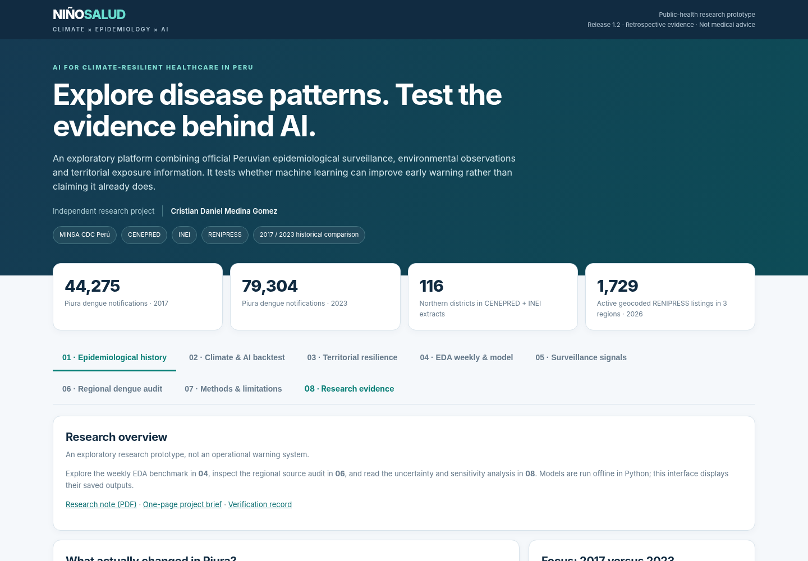

# NiñoSalud AI

> **Presentation update (27 October 2026):** aligned the author credit with the page grid, shortened the cover metadata and moved project background and AI-assistance details into **07 · Methods & limitations**. Research results and analytical code are unchanged.
### Climate, surveillance and reproducible evidence in northern Peru

**An independent, undergraduate-level research prototype by Cristian Daniel Medina Gomez.**
Built with substantial AI-assisted programming and research support. Release 1.2, 27 October 2026.



## The question
Can climate observations improve short-term prediction of reported diarrheal episodes, and how much do data-quality assumptions change the conclusions drawn from public-health records?

I chose Peru as the setting for a learning project connecting my undergraduate background in Economics and Management at Bocconi with my interest in data science and health sciences. NiñoSalud is not a university-endorsed research programme. It is a documented attempt to learn from real data, test models against simple alternatives, and report negative findings honestly.

## Read the evidence first
- [One-page project brief](docs/NinoSalud_Project_Brief.pdf)
- [Four-page research note](docs/NinoSalud_Research_Note.pdf)
- [Methods and model card](docs/MODEL_CARD.md)
- [Source inventory and data terms](docs/DATA_SOURCES.md)
- [Reproducibility guide](docs/REPRODUCIBILITY.md)
- [Verification record](docs/VERIFICATION_REPORT.md)

## What the project does
The browser dashboard brings together historical disease counts, weekly EDA and climate data, territorial snapshots, and a regional dengue source audit. The main experiment evaluates a **four-week-ahead target** for all-age acute diarrheal disease episodes (EDA) in Piura's eight provinces. A separate audit examines the sensitivity of recorded dengue date intervals to exclusion thresholds.

**The interface displays saved research outputs. It does not train models in the browser, retrieve live patient data, issue operational alerts, or forecast a 2027 epidemic.**

## Main results
Models were fitted using 2019–2022 and compared on **992 matched province-week predictions in 2023–2025**. This evaluation period was inspected during development: it is exploratory, not a pristine test set. Lower mean absolute error (MAE) is better.

| Method | MAE: reported episodes / province-week |
|---|---:|
| Last observed week (persistence) | **45.088** |
| Trailing four-week average | 46.673 |
| Random Forest + observed climate | 50.294 |
| Same Random Forest, without climate | 52.763 |
| Same week in the previous year | 71.954 |

Adding climate reduced the forest's observed error by about **4.7%**, but it did **not** make the forest better than persistence on this sample. This is the project's main negative result, not a failure hidden behind the dashboard.

A 5,000-resample province-year cluster bootstrap gives an approximate 95% interval of **−0.474 to +13.349 episodes** for climate-forest MAE minus persistence MAE. The 24 clusters may be correlated; the interval does not establish equivalence, superiority, or clinical utility.

### Data-quality findings
- The older national 2024 EDA age-5+ extract conflicts with a newer CDC export. Annual Piura counts were 15,451 versus 57,363. We keep the source versions separate; annual totals are never used to manufacture weekly observations.
- In the regional 2025 dengue cohort, Huancabamba's median recorded onset-to-attendance interval changes from **5 to 19 days** across maximum-inclusion thresholds of 30–365 days. Piura remains at **3 days**. These are recorded intervals, not verified access barriers or reporting delays.
- The source workbook contains **32 province-week rows with missing humidity in 2025**. Missing values remain missing. Charts show gaps rather than zeros.

## Open the app
Download the repository as a ZIP, extract it, and open **`index.html`** in Safari or Chrome. Keep all folders together. No Python, RStudio, API key or installation is needed to view the dashboard.

A hosted version can be enabled using GitHub Pages: publish `main` from `/(root)`. Once enabled, the repository owner can add the real site URL to the repository's About section. No hosted URL is claimed before deployment.

### Suggested three-minute reviewer route
1. **04 · EDA weekly & model:** select a province/year and compare observations with saved predictions.
2. **06 · Regional dengue audit:** compare Piura and Huancabamba in the 2025 cohort.
3. **08 · Research evidence:** inspect the negative result, uncertainty and threshold sensitivity.

The other views retain historical disease comparisons, an auxiliary dengue forecast benchmark, territorial context and descriptive seasonal-reference exceedances. These have different scopes and must not be combined into a single “risk score”.

## Reproduce the core analyses
Python **3.13.5** was used for release verification. Use an isolated environment.

```bash
python -m venv .venv
# macOS / Linux
source .venv/bin/activate
python -m pip install -r requirements.txt
python -m unittest discover -s tests -v
python research/eda_climate_ablation.py
python research/methodological_robustness_v11.py --no-regional
python research/eda_reference_signals.py
python research/legacy_dengue_backtest.py
```

To reconstruct the aggregate EDA input from the original CDC workbook or repeat the regional case-record audit, obtain the source files separately and follow [the reproducibility guide](docs/REPRODUCIBILITY.md). **Do not upload case-level records to the repository.**

## Repository layout
```text
app/        Offline HTML/CSS/JavaScript dashboard and saved aggregate payloads
assets/     Screenshots of the actual interface
data/       Aggregate analytical tables, source hashes and provenance
research/   Statistical scripts and saved research evidence
scripts/    Source-workbook extraction and release checks
tests/      Automated data and consistency checks
docs/       Research note, project brief, methods, source and verification records
```

## Limitations and intended use
This is a student research and learning tool. Outcomes are reported episodes or notifications, not unique people or independently adjudicated infections. Provincial results do not generalize to patients. Reporting revisions, missing climate fields, small effective samples and the pandemic-era reference period limit interpretation. No prospective validation or independent outbreak labels are available. A historical exceedance is not a proven epidemic or an early warning. The 2026 territorial snapshots are contextual and are **not historical model inputs**.

## Contribution and AI assistance
The project owner selected the Peru-focused question, collected source files, directed iterative revisions and tested the interface. Generative AI materially assisted code development, analysis, documentation and packaging. The release records which calculations and tests were rerun. This acknowledgement does not imply independent scientific review or external endorsement. See [contributions](docs/CONTRIBUTIONS.md).

## Reuse
Original project code and original explanatory text are offered under the [MIT License](LICENSE). This does **not** relicense CDC/MINSA, GORE Piura, CENEPRED, INEI or SUSALUD source data. Derived summaries retain source attribution; upstream terms must be checked before any further reuse. See [data terms](DATA_TERMS.md).

**Status:** prepared as a hackathon submission and academic portfolio project; no award, publication, admission outcome or official endorsement is claimed.
